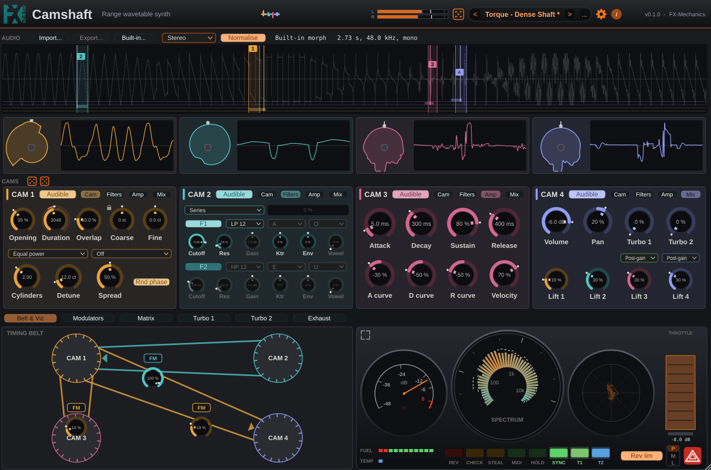
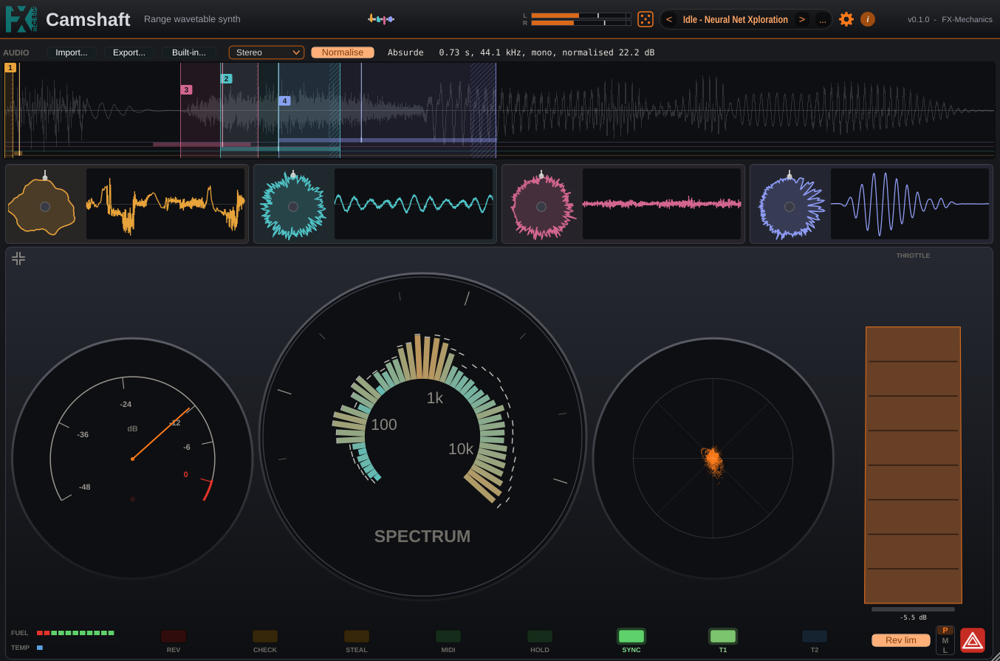
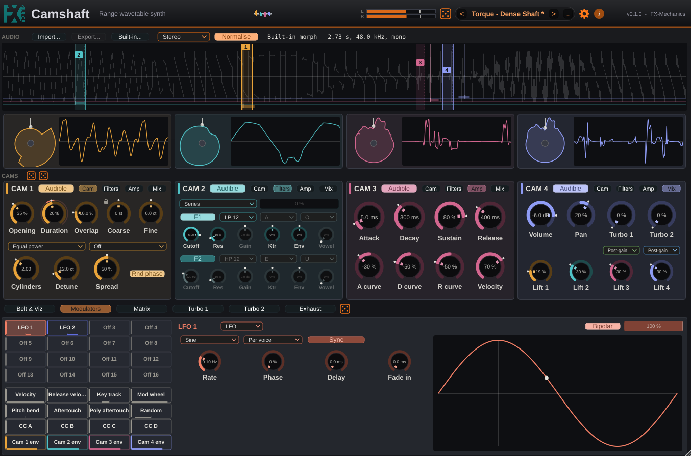
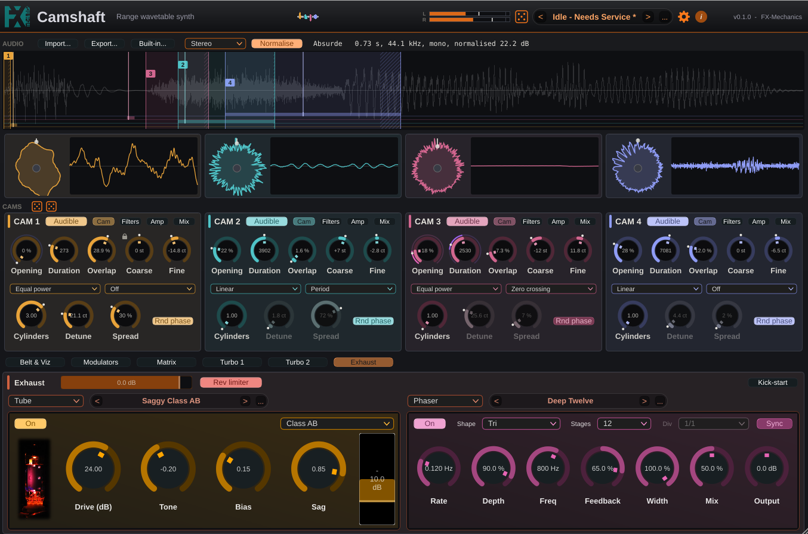
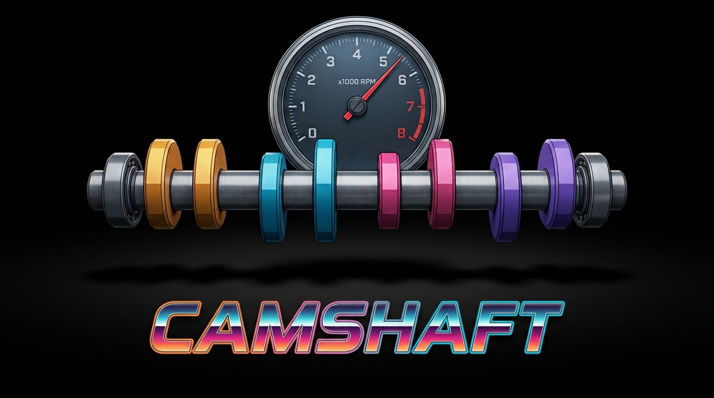

# Camshaft

A range wavetable synth, by FX-Mechanics.



Import an audio file, set up to four ranges on it, and play each range as a
wavetable at the pitch of the note: the whole range is one cycle of the wave,
whatever its length, so a slice of a voice, a drum loop or a field recording
becomes an oscillator. Each range (a "cam") has its own unison, two filters,
amp envelope, mix and effect sends. Sixteen modulators (LFOs, envelopes, drawn
curves) and the MIDI sources can drive any knob, including where each range
sits in the file, per voice. The cams can modulate each other (FM, ring, AM,
hard sync, and opening modulation, which moves a cam's read position at audio
rate). Two effect chains and a master chain reuse the FxmeFX effects.

The audio is stored inside the session and the presets, so a patch never
depends on a file path. Without a file, a built-in source plays: a morph of
waveforms, or one of the samples that come with Camshaft (the "Built-in..."
menu).

See [doc/architecture.md](doc/architecture.md) for how it works.

## Contents

- [Quick start](#quick-start)
- [The window](#the-window)
- [Using it](#using-it)
- [Installing](#installing)
- [Building](#building)
- [Licence](#licence)

## Quick start

1. Put Camshaft on an **instrument (MIDI) track** and play a note. The built-in
   morph sounds straight away. If nothing sounds, the cam scope rows stay flat
   and the profiles do not turn: no notes are arriving.
2. Pick a preset in the **Garage** (the preset box in the top bar; the arrows
   step through them).
3. Load your own sound: **Import...**, or drop an audio file on the waveform. Choose "Built-in..." for the morph or one of
   the bundled samples.
4. Drag the coloured ranges on the waveform and listen. Each cam plays its own
   range; turn a cam's **Audible** switch off to mute it.
5. Drag a modulator from the bottom band onto any knob to modulate it.

## The window

From top to bottom:

- **Top bar:** the output level meter, the global dice (randomize everything),
  the preset browser, the settings (gear) and the about button (i).
- **Audio:** the file controls (import, export, built-in sources, channel
  choice, normalise) and the waveform with the four ranges.
- **Cams:** one column per cam. Its profile (the range drawn as a cam, turning
  with the notes) and its oscilloscope, then its controls.
- **Bottom band:** six tabs. Belt & Viz, Modulators, Matrix, and the effect
  chains Turbo 1, Turbo 2 and Exhaust.

### Belt & Viz

The pane in the picture at the top. The left half is the **timing belt**: drag from one cam's pulley to another to
make the first modulate the second. The badge on a belt gives the type of
modulation; click it to cycle through them:

| Badge | Effect |
|---|---|
| FM | The first cam's output modulates the second's pitch (phase). |
| Ring | The two outputs are multiplied. |
| AM | The first cam's output sets the second's amplitude. |
| Sync | Hard sync: each cycle of the first restarts the second's cycle; the amount sweeps the driven cam up by as much as three octaves. |
| Open | Opening modulation: the first moves the second's read position in the file, at audio rate. |

The knob on the belt sets the amount. Double-click a pulley for feedback FM
(a cam modulating itself); loops between cams are refused. A cam that is not **Audible** is not
heard, but can still modulate the cams it drives.

The right half is the **dashboard**, laid out like a car's instrument cluster:
the output level (dial with a dB scale), the spectrum and the stereo image
(vectorscope), the warning lights, and the controls.



The button in the dashboard's top-left corner gives it the whole lower half of
the window, as above. Click it again to go back.

| Light or control | Meaning |
|---|---|
| REV | The rev limiter is reducing the level. |
| CHECK | The audio processing is near its time budget (above 90 % DSP load). Reduce the polyphony, switch cams off or use cheaper interpolation. |
| STEAL | A voice was stolen: the polyphony is used up. |
| MIDI | Notes are coming in. |
| HOLD | The sustain pedal is down. |
| SYNC | The host is playing: synced LFOs and curves follow its position. |
| T1, T2 | The Turbo chains are carrying signal. |
| FUEL | The voices still free. |
| TEMP | The DSP load. |
| P M L | Voice mode: poly, mono, legato. |
| Rev lim | The output safety limiter (-0.3 dBFS). |
| Hazard | Panic: silences every voice. |
| Throttle | The output level, as an accelerator pedal. Drag down to press it (louder). Shift for fine steps, double-click for the default. |

### Audio and cams

- **Audio.** Import a file (or drop it on the waveform: WAV, AIFF, FLAC, Ogg and the
  other formats the plugin reads). On the waveform, drag
  inside a cam's range (or its numbered flag) to move it, drag an edge to
  move that edge alone. While notes play, the bars along the bottom show the
  range each voice reads. The wheel zooms, a drag on empty space scrolls, a
  double-click shows the whole file. Export writes the current audio out as a
  WAV file.
- **Cams.** Under each cam's scope row, four pages:
  - **Cam:** *Opening* and *Duration* (where the range starts and how long it
    is; an opening plus a duration past the end is cut short), *Overlap* (the
    loop crossfade, linear or equal power), *Snap* (the range's ends move to
    zero crossings, or the duration becomes a whole number of periods of the
    sound), tuning (*Coarse*, *Fine*) and
    *Cylinders* (unison voices) with *Detune* and *Spread*. *Rnd phase*
    randomizes the start phase of each note.
  - **Filters:** two filters per cam, in series or in parallel. Types: low-pass
    and high-pass (12 and 24 dB), band-pass, notch, peak, shelves, and a
    **formant** filter (vowels, with a *Vowel* position morphing between two
    chosen vowels). *Cutoff*, *Res*, key tracking (*Ktr*) and an envelope
    (*Env*) shape them.
  - **Amp:** the amplitude envelope.
  - **Mix:** the volume, the pan, and the two Turbo sends.

### Modulators



Sixteen slots, each an **LFO**, an **ADSR** envelope or a drawn **curve**
(or off), and the MIDI sources below them: velocity, release velocity, key
track, mod wheel, pitch bend, aftertouch, poly aftertouch, a random value per
note, four assignable controllers (CC A to D) and each cam's envelope.

- Drag a slot (or a MIDI source) from the left onto any knob. The knob's
  outer ring shows the modulation, the dot its live value. Dragging onto a
  knob makes an empty slot an LFO. You can also right-click a knob and choose
  "Modulate from".
- A slot that modulates nothing is dimmed and not computed, so unused slots
  cost nothing.
- **LFO:** shape, rate (free or synced to the host tempo), per-voice or global.
- **ADSR:** attack, decay, sustain, release, with a curve for each stage.
- **Curve:** draw it with breakpoints. Time it in seconds or in beats (the
  editor then shows a beat grid, which you can snap to; both are set in the
  settings), loop it (including back and forth) and choose where the sustain
  and the release start. "Stick to DAW" makes it follow the host's position.
  While you hold a point, the waveform marks where it puts the ranges it
  modulates.
- The **Matrix** tab lists every route with its source, destination and depth;
  its depth bars take the colour of their source. A route can also pass through
  a second source (via), which scales it.

### Effects



Three chains, in the bottom band:

- **Turbo 1** and **Turbo 2** are fed by the cams' sends and returned to the mix
  at their own level and pan.
- **Exhaust** takes the whole mix. Its output level is also the dashboard's
  throttle pedal, and the **rev limiter** (a safety limiter at -0.3 dBFS) is
  always last.

Each chain holds two effects: delay, tube, EQ, compressor, cab, chorus,
flanger, phaser or reverb. Pick them in the boxes at the top of the pane. Each
has its own presets (the bar beside it), shared with its
[FxmeFX](https://github.com/odoare/FxmeFX) plugin.

## Using it

- **Presets** (the "Garage", top bar): the arrows step through them, "..."
  opens the browser to save, rename and delete. The factory presets are sorted
  by category (Idle, Torque, Rev, Backfire).
- **Kick-start:** the dice randomize a section (the cams, their filters, the
  modulators), or everything from the top bar. Right-click a knob to lock it
  so the dice leave it alone.
- **Knobs:** right-click to type a value or learn a MIDI controller.
- **MIDI learn:** any knob can be learnt. New instances can start with the
  current map (settings).
- **Settings** (the gear): the interpolation (linear, cubic or sinc: the
  cheapest to the flattest), polyphony, glide, pitch bend range, the beat grid
  of the curve editor and its snap, hover help on or off, and the MIDI learn
  map. "Keep audio when loading presets" lets you try presets on your own
  sound.
- **Hover help:** every control has a tooltip, including the units of the
  values (a range's length is in samples).
- **Performance:** a cam that is off, and a modulator that modulates nothing,
  cost nothing. If the CHECK light comes on, reduce the number of cylinders or
  the polyphony, or use linear interpolation.

## Installing

Download the archive for your system from the releases page and copy the
plugin to your plugin folder:

| System | VST3 | CLAP | AU |
|---|---|---|---|
| Linux | `~/.vst3/` | `~/.clap/` | |
| Windows | `C:\Program Files\Common Files\VST3\` | `C:\Program Files\Common Files\CLAP\` | |
| macOS | `/Library/Audio/Plug-Ins/VST3/` | `/Library/Audio/Plug-Ins/CLAP/` | `/Library/Audio/Plug-Ins/Components/` |

Then rescan the plugins in your host (most hosts cache the plugins they have
seen).

### macOS

Camshaft is free software and is not signed with an Apple Developer ID. macOS
marks anything downloaded through a browser as untrusted, and the host then
skips the plugin **silently** during its scan. Remove the quarantine flag for
what you installed, in Terminal:

```sh
xattr -dr com.apple.quarantine /Library/Audio/Plug-Ins/VST3/Camshaft.vst3
xattr -dr com.apple.quarantine /Library/Audio/Plug-Ins/CLAP/Camshaft.clap
xattr -dr com.apple.quarantine /Library/Audio/Plug-Ins/Components/Camshaft.component
```

then rescan. An unsigned `.pkg` opens with right-click, Open. The builds are
universal (Apple Silicon and Intel) and support macOS 10.13 and later.

## Building

Camshaft depends on JUCE 9, [FxmeTools](https://github.com/odoare/FxmeTools)
(with WDL inside it), [FxmeFX](https://github.com/odoare/FxmeFX) and, for
the CLAP format,
[clap-juce-extensions](https://github.com/free-audio/clap-juce-extensions),
pinned in `cmake/Dependencies.cmake`. There are no submodules: CMake uses a sibling
clone (`../JUCE`, `../FxmeTools`, `../FxmeFX`) when there is one, and
otherwise downloads the pinned commit. The configure step prints which one it
took for each.

```sh
cmake -S . -B build -DCMAKE_BUILD_TYPE=Release
cmake --build build --target Camshaft_VST3 -j2
```

For a release, ignore the sibling clones and build from the pins only:

```sh
cmake -S . -B build -DCMAKE_BUILD_TYPE=Release -DFXME_USE_SIBLINGS=OFF
```

Builds do not install: copy `build/Camshaft_artefacts/Release/VST3/Camshaft.vst3`
(or `CLAP/Camshaft.clap`, target `Camshaft_CLAP`) to your plugin folder and
rescan.

The sound engine builds and tests without JUCE:

```sh
cmake --build build --target CamshaftEngineTest -j2 && ./build/CamshaftEngineTest
```

## Licence

Same terms as FxmeTools: the JUCE-free engine (`Source/Engine`) is under the
LGPL 3.0 or later; the plugin around it under the AGPL 3.0 or later, or
commercial terms from the author. See [LICENSE.md](LICENSE.md).


